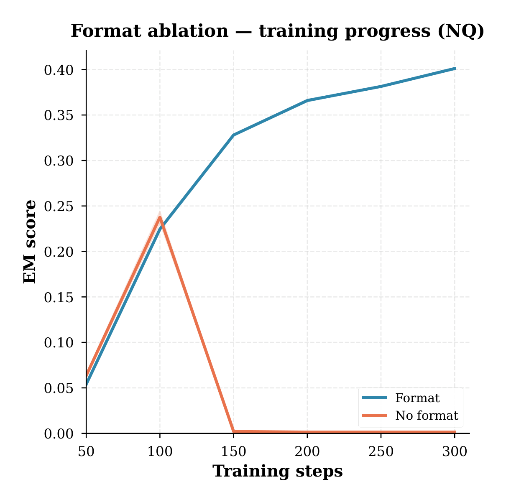
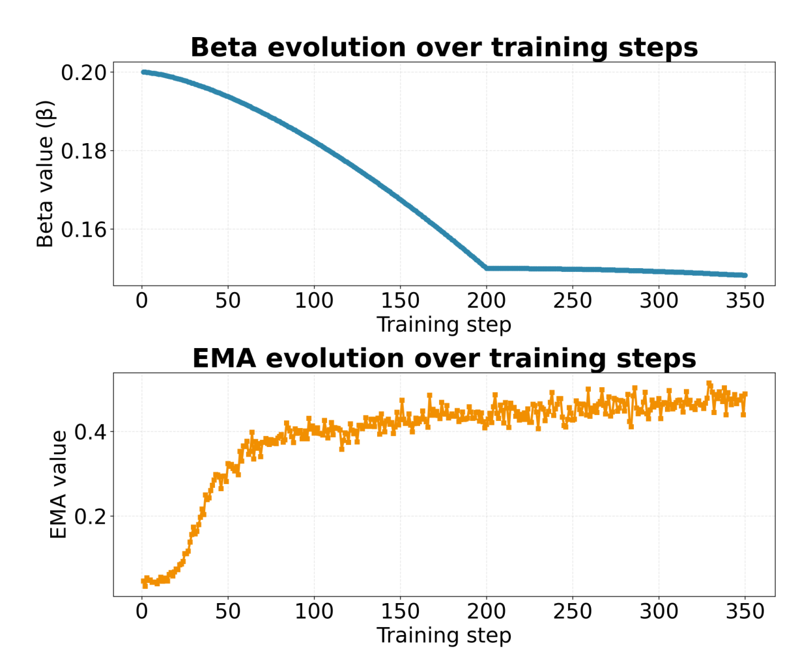
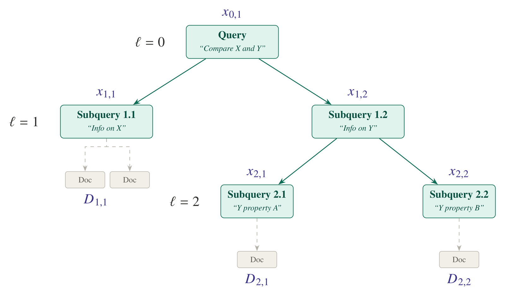

# SubSearch: Intermediate Rewards for Unsupervised Guided Reasoning in Complex Retrieval

<p align="center">
  <a href="https://arxiv.org/abs/2604.07415">
    
  </a>
  &nbsp;&nbsp;
  <a href="https://huggingface.co/RoxanaMaria/SubSearch-qwen2.5-3b-grpo">
    
  </a>
</p>

**SubSearch** is a reinforcement learning (RL) framework designed for training **hierarchical reason-and-search LLMs**. While standard models often struggle with complex, multi-hop information needs, SubSearch enables language models to autonomously decompose a query into a verifiable tree of sub-queries.

Built upon veRL and extending the foundational ideas of Search-R1 and DeepSeek-R1, SubSearch introduces a dual-level reward system. It moves beyond simple outcome-based rewards by integrating intrinsic process sensors: Splittability (rewarding logical decomposition at the query level) and Answerability (rewarding document sufficiency at the sub-query level). This creates a robust, open-source RL training pipeline for building agents capable of deep, multi-step research.

We support various RL methods (e.g., PPO, GRPO), diverse base models (e.g., Llama 3.2, Qwen 2.5), and flexible retrieval backends, ranging from local vector stores to live web search.

## Installation

### Search-r1 environment
```bash
conda create -n subsearch_rl python=3.9
conda activate subsearch_rl

pip install torch==2.4.0 --index-url [https://download.pytorch.org/whl/cu121](https://download.pytorch.org/whl/cu121)
pip install vllm==0.6.3 flash-attn --no-build-isolation

pip install verl outlines sentence-transformers wandb
pip install -e .
```

### Retriever environment (optional)
If you would like to call a local retriever as the search engine, you can install the environment as follows. (We recommend using a seperate environment.)
```bash
conda create -n retriever python=3.10
conda activate retriever

conda install pytorch==2.4.0 torchvision==0.19.0 torchaudio==2.4.0 pytorch-cuda=12.1 -c pytorch -c 
pip install transformers datasets pyserini

conda install -c pytorch -c nvidia faiss-gpu=1.8.0
pip install sentence-transformers openai pydantic-settings tiktoken

pip install uvicorn fastapi
```


## Quick start

Train a reasoning + search LLM on NQ dataset with e5 as the retriever and wikipedia as the corpus.

(1) Download the indexing and corpus.
```bash
save_path=/path/to/save/data
python scripts/download.py --save_path $save_path
cat $save_path/part_* > $save_path/e5_Flat.index
gzip -d $save_path/wiki-18.jsonl.gz
```

(2) Process the NQ dataset. Change template_type for prompt decomposition. 
```bash
python scripts/data_process/nq_search.py
```

(3) Launch a local retrieval server.
```bash
export RETRIEVER_IP_PATH=/path/to/save/IP/file
export DATA_PATH=/path/to/data
conda activate retriever
bash run_retriever.sh
```

(4) Run RL training (PPO) with Llama-3.2-3b-base.
```bash
export RETRIEVER_IP_PATH=/path/to/save/IP/file
export DATA_PATH=/path/to/data
export SAVE_DIR_BASE=/path//to/checkpoints
conda activate subsearch_rl
bash train_grpo.sh
```

## Appendix

Material that did not fit the paper's page limit.

### A. Experimental setup

We follow a setup similar to prior work, combining the Natural Questions (NQ) and HotpotQA datasets for training. Backbones are Qwen2.5-3B and Qwen2.5-3B-Instruct, trained with GRPO through the verl framework on 4 NVIDIA H100 GPUs.

| Setting | Value |
|---|---|
| Group size | 5 |
| Rollout temperature | 1.0 |
| Training batch size | 512 |
| Validation batch size | 256 |
| Max prompt length | 4096 tokens |
| Max response length | 500 tokens |
| Observation length | 1200 tokens |
| Learning rate | 1 x 10^-6 |
| KL divergence coefficient (`kl_loss_coef`) | 0.001 |

#### Comparison of search agent methods

`✓` / `–`: present / absent. **Evidence**: retrieved external documents. **Decomp.**: query decomposition. **Interm.**: subquery-level intermediate reward. **1g+2i**: 1 global + 2 intermediate.

| Method | Evidence | SFT | Rewards | RL type | Training data | Decomp. | Interm. |
|---|:--:|:--:|---|:--:|---|:--:|:--:|
| Direct Inference | – | – | – | – | – | – | – |
| CoT | – | – | – | – | – | – | – |
| SFT | – | ✓ | – | – | – | – | – |
| RAG | ✓ | – | – | – | – | – | – |
| Search-o1 | ✓ | – | – | – | – | – | – |
| R1-base | – | – | EM | global | NQ+HotpotQA | – | – |
| Search-R1 | ✓ | – | EM | global | NQ+HotpotQA | – | – |
| ZeroSearch | – | – | EM | global | NQ+HotpotQA | – | – |
| StepSearch | ✓ | – | EM | global | MuSiQue | ✓ | – |
| R-Search | ✓ | – | EM+evidence q. | global | 2wiki | – | – |
| InForage | ✓ | ✓ | EM+gain+eff. | global | NQ+HotpotQA | – | – |
| O2-Searcher | ✓ | ✓ | EM+fact+div. | global | NQ+HotpotQA | – | – |
| **SubSearch** | ✓ | – | EM+ans+dec. | **1g+2i** | NQ+HotpotQA | ✓ | ✓ |

### B. Format analysis

Adding a format signal is what keeps training from collapsing early. Non-decomposed generations are relatively stable on their own, but parallel decomposition makes the generation more complex and therefore more volatile. SubSearch consequently trains on a combination of outcome-only, intermediate and format rewards.

```text
            ⎧ 0                               if f_format = False ∧ f_retrieval = False
r_format =  ⎨ λ_structure                     if f_format = True  ∧ f_retrieval = False
            ⎩ λ_structure + λ_retrieval       if f_format = True  ∧ f_retrieval = True
```

where `λ_structure` and `λ_retrieval` are set values.

<p align="center">
  
</p>

<p align="center"><sub>Training progress of Qwen2.5-3B-base on NQ with GRPO and EM as reward, with and without a format signal. Without it the run collapses to zero by step 150.</sub></p>

### C. Adaptive beta

<p align="center">
  
</p>

<p align="center"><sub>Evolution of the adaptive weight β over training. A higher β puts more weight on the intermediate rewards; as the model gets better at producing a correct answer, β falls and priority shifts to the binary outcome reward. A higher EMA means recent reasoning traces are weighted more heavily than older ones.</sub></p>

### D. Query decomposition and rewards

<p align="center">
  
</p>

<p align="center"><sub>Notation for query decomposition and intermediate reward computation. <code>ℓ</code> is the decomposition layer (root = 0), <code>i</code> the index within a layer, <code>x_{ℓ,i}</code> a subquery at layer ℓ and index i, and <code>D_{ℓ,i}</code> the documents retrieved for it.</sub></p>

### E. Prompt template

The question is appended during both training and inference.

```text
Answer the given question. You must conduct reasoning inside <think> and </think> first every time you get new information. After reasoning, if you find you lack some knowledge, you can call a search engine by <search> query </search>, and it will return the top searched results between <information> and </information>.

If the original query is complex or involves multiple parts, you are encouraged to decompose it into at most 3 smaller sub-questions, separated by ##. For example: <search> sub-question 1 ## sub-question 2 </search> and it will return the top searched results between <information> documents sub-question 1 ## documents sub-question 2 </information>.

You can search as many times as you want. Only decompose when the question has multiple independent parts (e.g., different entities, aspects, or comparisons). Do not decompose questions that do not need it.

If you find no further external knowledge needed, you can directly provide the answer inside <answer> and </answer> without detailed illustrations. For example, <answer> Beijing </answer>.

Question: {question}
```

### F. Case study 1 — parallel decomposition (successful)

SubSearch decomposes the information need into parallel subqueries and aggregates the retrieved documents into a correct answer.

**Question:** Which bank has more branches, China CITIC Bank or UniCredit?
**Ground truth:** UniCredit

```text
<think> First, I need to find information about China CITIC Bank. </think>
<search> how many branches does UniCredit have bank </search>
<information> Doc 1 (Title: "UniCredit Bank Romania") UniCredit Bank Romania UniCredit Bank is a leading European Bank, member of UniCredit Group, with a network of 8.500 branches in 17 European countries and it is present in another 50 international markets Being one of the top 5 banks on the Romanian market, UniCredit Bank has 208 branches and almost 3000 employees. At the end of 2015, the bank had total assets in amount of 34,6 billion RON and included approximately 600.000 active customers...
Doc 2 (Title: UniCredit) UniCredit UniCredit S.p.A. is an Italian global banking and financial services company. Its network spans 50 markets in 17 countries, with more than 8,500 branches and over 147,000 employees...
Doc 3 (Title: UniCredit) subsidiary Bank Austria). Until 2018 UniCredit was one of the UEFA Champions League's main sponsors. UniCredit UniCredit S.p.A. is an Italian global banking and financial services company. Its network spans 50 markets in 17 countries, with more than 8,500 branches and over 147,000 employees... </information>

<think> Based on the information found, I need to compare the number of branches of China CITIC Bank and UniCredit. </think>
<search> how many branches does China CITIC Bank have </search>
<information> Doc 1 (Title: "China CITIC Bank") China CITIC Bank is China's seventh-largest lender in terms of total assets. It was known as CITIC Industrial Bank until it changed its name in August 2005. China CITIC Bank, established in 1987, is a nationally comprehensive and internationally oriented commercial bank. The bank operates in almost 130 countries, and maintains a strong foothold on the mainland banking industry. The bank operates 78 branches in the mainland, and 622 sub-branches, located in economically developed regions of China. In total, there are 773 branch offices in China, as of Q4 2011...
Doc 2 (Title: "China CITIC Bank") financing services for small enterprises, trading services, cash management, asset management, international settlement and trade financing, capital market business... 
Doc 3 (Title: UniCredit) the bank was also relocated from Genoa (inherited from Credito Italiano) to 17 via Minghetti, Rome... </information>
<think> Based on the information, China CITIC Bank has 773 branches, while UniCredit has 8,500 branches. </think>
<answer> UniCredit </answer>
```

### G. Case study 2 — sequential decomposition (successful)

Here the subqueries are sequential: the answer to the first is needed to formulate the second.

**Question:** Which team did Joe Buck's father broadcast for?
**Ground truth:** St. Louis Cardinals

```text
<think> First, I need to find information about Joe Buck. </think>
<search> who is joe buck father broadcast </search>
<information> Doc 1 (Title: "Joe Buck") ... Joe Buck Joseph Francis Buck (born April 25, 1969) is an American sportscaster and the son of sportscaster Jack Buck. He has won numerous Sports Emmy Awards for his work with Fox Sports...
Doc 2 (Title: "Joe Buck") the team's broadcasting crew. In 1994, Buck was hired by Fox, and at the age of 25 became the youngest man ever to announce a regular slate of National Football League games on network television...
Doc 3 (Title: "Joe Buck") Joe Buck Joseph Francis Buck (born April 25, 1969) is an American sportscaster and the son of sportscaster Jack Buck... </information>
<think> I now need to find which team his father broadcast for. </think>
<search> who did jack buck broadcast for </search>
<information> Doc 1 (Title: "Jack Buck") a railroad accountant who commuted weekly to New Jersey. From an early age, Buck dreamed of becoming a sports announcer...
Doc 2 (Title: "Jack Buck") ... While much better known for his baseball and football commentary, Jack Buck was also the original voice of the St. Louis Blues of the National...
Doc 3 (Title: "Jack Buck") Jack Buck John Francis "Jack" Buck (August 21, 1924 – June 18, 2002) was an American sportscaster, best known for his work announcing Major League Baseball games of the St. Louis Cardinals... </information>
<think> Therefore, Joe Buck's father broadcast for the St. Louis Cardinals. </think>
<answer> St. Louis Cardinals </answer>
```

### H. Case study 3 — sequential decomposition with a wasted hop (successful)

Correct, but note that the first search is useless: it asks when Chris Stockley died rather than who shot him.

**Question:** In what year did the man who shot Chris Stockley, of The Dingoes, die?
**Ground truth:** 1987

```text
<think> First, I need to find information about Chris Stockley. </think>
<search> when did Chris Stockley of The Dingoes die </search>
<information> Doc 1 (Title: "The Dingoes") The Dingoes is an Australian country rock band initially active from 1973 to 1979... Mal Logan on keyboards joined after Stockley was hospitalised when shot in the stomach by Melbourne drug-dealer, Dennis Allen, who was attempting to gate crash a party...
Doc 2 (Title: "The Dingoes") ... A week before the single was released Stockley received a serious gunshot wound during an incident at a party in Melbourne that resulted in a two-month stay in hospital...</information>
<think> Now, I need to find information about the man who shot him. </think>
<search> who shot Chris Stockley of The Dingoes </search>
<information> Doc 1 (Title: "The Dingoes") ... Stockley was shot by notorious drug dealer Dennis Allen, who was trying to gate crash the party...
Doc 2 (Title: "The Dingoes") The Dingoes is an Australian country rock band initially active from 1973 to 1979... </information>
<think> I now need to find when Dennis Allen died. </think>
<search> when did Dennis Allen die </search>
<information> Doc 1 (Title: "The Dingoes") ... Stockley was shot by notorious drug dealer Dennis Allen, who was trying to gate crash the party...
Doc 2 (Title: "Dennis Allen (criminal)") in 1985. One victim who survived was guitarist Chris Stockley of The Dingoes, whom Allen shot in the stomach while attempting to gatecrash a party. Allen received a ten-year prison sentence for rape during the 1970s... </information>
<think> Therefore, the man who shot Chris Stockley died in 1987. </think>
<answer> 1987 </answer>
```

### I. Case study 4 — failed decomposition and spurious grounding (unsuccessful)

SubSearch gets stuck generating near-identical queries. The reasoning is well formed, but the model never asks the right second question, and grounds its answer in a theatre that merely staged the musical.

**Question:** At what theater is the composer and lyricist for the musical Big Fish a residential artist?
**Ground truth:** Ars Nova Theater

```text
<think> First, I need to find the composer and lyricist of Big Fish. </think>
<search> what is the theater of Big Fish musical composer lyricist residential artist </search>
<information> Doc 1 (Title: "Big Fish (musical)") Big Fish is a musical with music and lyrics by Andrew Lippa and book by John August. It is based on Daniel Wallace's 1998 novel and the 2003 film "Big Fish"...
Doc 2 (Title: "Big Fish (musical)") ... "Variety" reviewer Marilyn Stasio wrote: "Norbert Leo Butz is cutting loose in another one of his don't-dare-miss-this perfs in 'Big Fish'"...
Doc 3 (Title: "Big Fish: A Novel of Mythic Proportions") a 1998 novel by Daniel Wallace. It was adapted into a film, "Big Fish", in 2003 by Tim Burton...</information>
<think> Now I need to find where Andrew Lippa is a resident artist. </think>
<search> where is the theater of composer lyricist Big Fish residential artist </search>
<information>Doc 1 (Title: "Big Fish (musical)") Big Fish is a musical with music and lyrics by Andrew Lippa and book by John August...
Doc 2 (Title: "Big Fish (musical)") ... The show received its London premiere in November 2017 at The Other Palace... 
Doc 3 (Title: "Andrew Lippa") ... "Big Fish", Lippa's newest musical, with a book by John August, premiered in Chicago, Illinois at the Oriental Theatre from April 2013 through May 5, 2013. It opened on Broadway at the Neil Simon Theatre October 6, 2013...</information>
<think> The musical is associated with the Neil Simon Theatre, so the composer is likely a
resident artist there. </think>
<answer> Neil Simon Theatre </answer>
```

The second search is a near-paraphrase of the first and returns almost the same documents. The model then substitutes "the theatre where the musical opened" for "the theatre where its composer is a resident artist" — a well-formed trace that the intermediate rewards score highly, producing a wrong answer.
